# Agama on Whitechain

**agUSD: a synthetic dollar that earns private credit yield, settled on Whitechain.**

Deposit USDC, hold agUSD. agUSD is an OpenZeppelin ERC-4626 vault share, so the yield is in its price: nothing to stake, claim or come back for. The vault sends its capital over CCTP V2 to Ethereum, where a receiver subscribes it to an asset-backed finance (ABF) issuer. The issuer off-ramps the cash to fund receivables off chain, marks the book against a loan tape, and brings the collections home.

This is the Whitechain port of [app.agama.finance/stellar](https://app.agama.finance/stellar) ([agama-soroban](https://github.com/agamafinance/agama-soroban)), with one deliberate change: **one token instead of two.** The Stellar deployment mints agUSD and then stakes it into sagUSD for the yield. On an EVM chain the ERC-4626 share price already is the yield, so agUSD does both jobs.

## Architecture

```mermaid
flowchart LR
    U["Holder"]

    subgraph WC["Whitechain Sepolia (OP Stack L2, chain 1874)"]
        V["agUSD<br/>ERC-4626 vault<br/>buffer · FIFO queue · vesting"]
        A["CrossChainAllocator<br/>sole ALLOCATOR_ROLE"]
        WM["AttestedMessenger<br/>CCTP V2 wire format"]
    end

    subgraph ETH["Ethereum Sepolia (L1, CCTP domain 0)"]
        EM["AttestedMessenger<br/>CCTP V2 wire format"]
        R["AgamaL1Receiver<br/>CCTP V2 hook wrapper"]
        I["AbfAssetIssuer<br/>closed ERC-4626 · allowlist<br/>abfUSD-T notes"]
    end

    subgraph OFF["Off chain"]
        C["Custody / SPV<br/>receivables book<br/>loan tape"]
    end

    K["Keeper<br/>attester · relayer · NAV reporter"]

    U -- "deposit USDC / redeem" --> V
    V -- "pushToStrategy" --> A
    A -- "depositForBurnWithHook" --> WM
    WM -. "MessageSent" .-> K
    K -- "relay(message, attestation)" --> R
    R -- "receiveMessage" --> EM
    R -- "deposit at NAV" --> I
    I -- "offRamp" --> C
    C -- "onRamp: principal + interest" --> I
    R -- "redeemAndSendHome" --> EM
    EM -. "MessageSent" .-> K
    K -- "settleReturn" --> A
    A -- "returnFromStrategy" --> V
    K -- "reportNav" --> V
```



### Contracts

| Contract | Chain | What it does |
| --- | --- | --- |
| [`AgUSD`](contracts/src/whitechain/AgUSD.sol) | Whitechain | The product. OZ `ERC4626` + `ERC20Permit` + `AccessControl` + `Pausable` + `ReentrancyGuard`, six decimals like USDC. |
| [`CrossChainAllocator`](contracts/src/whitechain/CrossChainAllocator.sol) | Whitechain | The only holder of the vault's `ALLOCATOR_ROLE`. Burns towards the L1 receiver with a subscribe hook, and settles returns into the vault. |
| [`AgamaL1Receiver`](contracts/src/l1/AgamaL1Receiver.sol) | Ethereum | agUSD's position on the L1. The CCTP V2 hook wrapper Circle documents: it calls `receiveMessage` itself, then subscribes what arrived. |
| [`AbfAssetIssuer`](contracts/src/l1/AbfAssetIssuer.sol) | Ethereum | The simulated ABF issuer. A closed ERC-4626: allowlisted holders only, redemptions only against cash on hand, an off-chain book capped at 90% of assets. |
| [`AttestedMessenger`](contracts/src/cctp/AttestedMessenger.sol) | both | Burn-and-mint transport that speaks CCTP V2: Circle's signatures, Circle's message layout, Circle's attestation encoding. |
| [`CctpMessageV2`](contracts/src/libraries/CctpMessageV2.sol) | both | Reads and writes MessageV2 and BurnMessageV2 at Circle's offsets. |
| [`TestUSDC`](contracts/src/mocks/TestUSDC.sol) | both | Six decimal test dollar with a faucet: 10,000 an hour. |

## How agUSD works

```
totalAssets = idle + deployed - pending - unvested
```

| Term | Meaning |
| --- | --- |
| `idle` | USDC in the vault |
| `deployed` | USDC out on the book, valued at the last NAV report |
| `pending` | USDC owed to the redemption queue, fixed when each request was made |
| `unvested` | Reported profit that is still unlocking |

**Two speeds of exit.** `withdraw` and `redeem` are the standard ERC-4626 paths, and `maxWithdraw` and `maxRedeem` report what the liquid buffer can honestly pay. Above that, `requestRedeem` burns the shares at today's price and joins a FIFO queue. Anyone can settle the queue with `settleRedemptions`, and every return from the book settles it automatically. A holder who has asked to leave neither earns nor loses on the book after that, which keeps the queue fair to the holders who stay. It also makes the queue senior: if a loss ever exceeded the remaining holders' equity, `totalAssets` reads zero rather than negative, and the invariant suite pins that.

**Reports cannot be sandwiched.** A gain unlocks linearly over `profitVestingPeriod`. The lock and the fee shares are solved for together so two things hold at once:

1. the price does not move in the report's own block, so nobody can buy just before a report and sell just after it
2. once the gain has fully unlocked, the treasury's shares are worth exactly the performance fee

```
feeShares = S · F / (V − F)
locked    = V − P · V / (V − F)
```

`V` is the vault fully vested, `P` its value before the gain, `S` the supply and `F` the fee. Cash that comes home above the booked value is recognised the same way as a reported gain, so it never lands in the price all at once.

**A loss eats unvested profit first**, before it reaches the price.

**Guards on the key that moves the price.** The NAV reporter has to wait `minReportInterval` between reports, and each report can move the price by at most `maxNavChangeBps`. With nothing deployed, the only valid report is zero. The allocator can never spend through the reserve floor.

## Why there is a messenger here and not Circle's

**Circle has not given Whitechain a CCTP domain.** Whitechain does not appear on Circle's supported chains page, and its only USDC is USDC.e, bridged through WhiteBIT's Portal.

The allocator and the receiver are written against Circle's `ITokenMessengerV2` and `IMessageTransmitterV2`, never against anything of ours. Messages use Circle's MessageV2 and BurnMessageV2 layout byte for byte, and attestations are signatures over `keccak256(message)`, the way Circle's attestation API returns them. The day Circle supports Whitechain, moving over is a constructor argument, not a code change.

Where the messenger differs from Circle, on purpose:

- **One attester instead of Circle's quorum.** The trust assumption is one key, and it is ours.
- **The nonce is assigned on chain** at send time. Circle's V2 assigns it off chain, at attestation time.
- **No fast transfers.** Every message runs at the finalized threshold, and fees are zero.

Every burn in both directions names the contract on the far side as `destinationCaller`. That makes `relay` and `settleReturn` the only way the USDC can arrive, so nobody can execute a message and skip the subscription or settlement meant to follow it.

## What is simulated, and what is not

| | |
| --- | --- |
| **Real** | Every contract, both chains, every transfer, every burn and mint, the vault's accounting, the queue, the guards. |
| **Simulated** | The ABF partner, who runs no testnet. `AbfAssetIssuer` stands in, with their doors and their cash rule. Custody is the deployer's key, and borrower interest is minted at custody when collections are on-ramped. |
| **Simulated** | Circle's attestation service, played by the keeper's attester key. |
| **Testnet tempo** | Reports every 10 minutes and a 6 hour profit unlock, so a demo moves while somebody watches. |

The book accrues at 9% APR, the target of the partner's senior Flagship sleeve (8 to 9%). Each mark carries the hash of a loan tape listing the pools and what they have outstanding, so the figure on chain names a document an auditor could ask for.

## Why Whitechain

These facts come from [docs.whitechain.io](https://docs.whitechain.io) and were checked against the live RPC on 29 October 2026.

- **An OP Stack L2 that settles on Ethereum** (since 26 October 2026). The ABF issuer is on Ethereum, so agUSD sits one hop from its collateral, on the same security root.
- **One second blocks and fees in fractions of a cent.** The base fee floor is 5 gwei, plus the L1 data fee, which is posted as blobs. A deposit confirms before the page repaints.
- **WhiteBIT behind it.** A European exchange with 10M+ clients, and WBT can be withdrawn straight to the chain. That is the shortest path from a retail account to a yielding dollar.
- **Positioned for asset-backed businesses.** Whitechain pitches itself as "the Onchain Economy Layer" for fintechs, banks and tokenization desks, which are the originators an ABF book is made of.
- **The Builders Program** funds up to $300K per team in milestone tranches.
- **Prague EVM.** PUSH0, MCOPY and transient storage all work, Multicall3 is at the canonical address, and Blockscout verification works out of the box.

## Run it

```sh
# contracts
cd contracts
forge test                       # 45 tests: unit, fuzz, invariants, the whole route in one EVM

# deploy (DEPLOYER_KEY, ATTESTER in contracts/.env, see .env.example)
forge script script/DeployWhitechain.s.sol --rpc-url whitechain_sepolia --broadcast \
  --verify --verifier blockscout --verifier-url https://explorer.testnet.whitechain.io/api/
forge script script/DeployL1.s.sol --rpc-url sepolia --broadcast
forge script script/WireWhitechain.s.sol --rpc-url whitechain_sepolia --broadcast
./script/export-abis.sh

# keeper (needs ATTESTER_KEY too)
cd ../keeper && bun install
bun src/cli.ts status
bun src/cli.ts tick               # relay, run the book, rebalance, mark, settle the queue

# app
cd ../web && pnpm install && pnpm dev   # http://localhost:3007
```

## Layout

```
contracts/   Foundry. src/whitechain, src/l1, src/cctp, src/libraries, test/, script/
keeper/      bun + viem. Attester, relayer, the issuer's operations, NAV reporter
abi/         Generated from the build, shared by keeper and web
web/         Next 16 + wagmi + RainbowKit. Earn, Portfolio, Transparency, Faucet
```

## License

Apache-2.0
